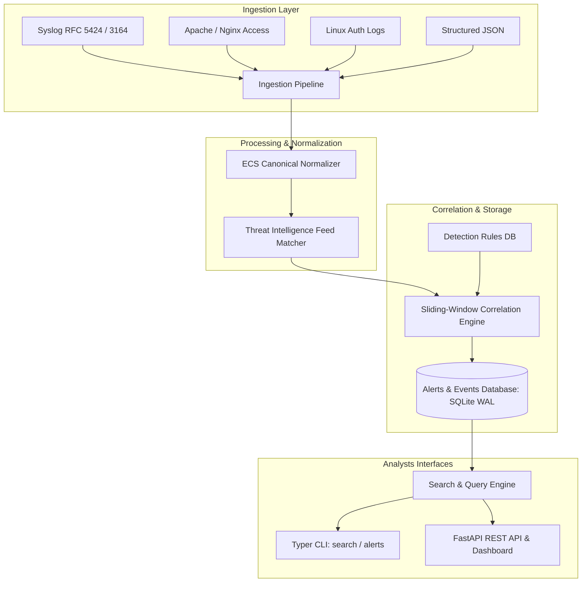

# Mini SIEM (Security Information & Event Management)

High-performance, pure-Python Security Information and Event Management (SIEM) system featuring multi-source log ingestion, canonical normalization, real-time threat correlation, and local web dashboard.

[](https://github.com/Krish9800/mini-siem/actions)
[](https://www.python.org/)
[](https://fastapi.tiangolo.com/)
[](https://sqlite.org/)
[](https://www.elastic.co/guide/en/ecs/current/index.html)

---

## Overview & Problem Statement

Security Operations Centers (SOCs) depend on SIEM platforms to aggregate disparate log sources and detect distributed attack patterns. However, enterprise SIEM solutions are resource-intensive, closed-source, and complex to deploy for testing and research.

**Mini SIEM** provides a modular, lightweight, fully-featured SIEM implementation in Python 3.12. It ingests Syslog, JSON, Apache/Nginx, and auth logs, maps them into canonical Elastic Common Schema (ECS) events, correlates multi-stage attack patterns using sliding time-windows, checks against threat intelligence feeds, and exposes search capabilities via CLI and REST APIs.

---

## Architecture & Data Flow



---

## Verified Features

- **Multi-Source Ingestion:** Ingests Syslog (RFC 3164 / 5424), Linux auth logs (`/var/log/auth.log`), Web access logs (Nginx/Apache), and structured JSON.
- **Canonical ECS Mapping:** Normalizes heterogeneous event records into a standardized Elastic Common Schema model with source/destination IPs, timestamps, actions, and user identities.
- **Sliding-Window Correlation:** Detects complex multi-stage attack sequences (e.g. repeated failed logins within 60s followed by successful sudo privilege escalation).
- **Threat Intelligence Lookup:** Real-time lookup of IP addresses and domains against ingested malicious IOC lists.
- **Persistent Storage:** SQLite with Write-Ahead Logging (WAL) and indexed event timestamp querying for zero-infrastructure deployment.
- **Dual Control Plane:** CLI utility for terminal searches and alerts, plus a FastAPI backend for SIEM dashboard integration.

---

## Technology Stack

- **Runtime:** Python 3.12+
- **API Framework:** FastAPI & Uvicorn
- **Data Validation:** Pydantic v2 & Pydantic-Settings
- **Storage:** SQLite with WAL mode
- **CLI:** Typer & Rich
- **Quality & Testing:** Pytest, Ruff, Mypy, Bandit

---

## Requirements & Installation

### Requirements
- Linux / macOS / WSL2 on Windows
- Python 3.12+
- SQLite 3.35+

### Installation

```bash
# Clone the repository
git clone https://github.com/Krish9800/mini-siem.git
cd mini-siem

# Create and activate virtual environment
python3 -m venv .venv
source .venv/bin/activate

# Install package
pip install -e .
```

---

## Verified Usage Examples

### 1. Command-Line Interface (CLI)

```bash
# Ingest an Apache access log file
mini-siem ingest sample_data/access.log --source-type apache

# Ingest Linux authentication logs
mini-siem ingest sample_data/auth.log --source-type auth

# Search ingested events using field filters
mini-siem search "status=failed action=login" --limit 20

# List generated security alerts by severity
mini-siem alerts --severity high

# Inspect active correlation detection rules
mini-siem rules

# View active Threat Intelligence indicators (IOCs)
mini-siem intel
```

### 2. Launching the Web Service & Dashboard

```bash
# Start the SIEM control plane
mini-siem serve --host 127.0.0.1 --port 8000
```

Open `http://127.0.0.1:8000/docs` to test interactive endpoints:
- `GET /api/v1/health` — System status and database metrics
- `POST /api/v1/search` — Query event logs using structured field filters
- `GET /api/v1/alerts` — Fetch correlated alerts with MITRE ATT&CK tags
- `GET /api/v1/rules` — List or register new YAML/JSON correlation rules
- `POST /api/v1/threat-intel` — Ingest new malicious IOC feeds

---

## Testing & Quality Gates

```bash
# Run complete test suite with coverage
pytest --cov=mini_siem --cov-report=term-missing

# Run correlation engine tests specifically
pytest tests/unit/test_correlation.py

# Linting and static analysis
ruff check .
ruff format --check .
mypy src/mini_siem
```

---

## Security Model & Threat Boundaries

- **Local Storage Isolation:** Event data is stored in a locally contained SQLite database with parameterized queries preventing SQL injection.
- **Log Forgery Defense:** Ingestion parsers sanitize line feeds and escape control characters to prevent log injection and terminal escape sequence vulnerabilities.
- **Threat Intel Matching:** Lookups execute locally against cached hash maps without leaking internal queried IPs to external third parties.

---

## Limitations & Known Issues

- **Storage Scaling:** Designed for edge deployments, lab ranges, and micro-SOC environments (< 5,000 EPS). Large enterprise volumes require PostgreSQL or ClickHouse adapters.
- **Deduplication Persistence:** In-memory alert suppression tables clear on process restart; persistent state tracking is planned for the next release.

---

## Roadmap

- [ ] Persistent alert suppression table in SQLite.
- [ ] Direct export to Sigma detection rule format.
- [ ] Automated synthetic log generator CLI command.

---

## License & Responsible Use

This project is released under the **MIT License**.

> [!NOTE]
> Designed for defensive security operations, threat hunting research, and cybersecurity education.
